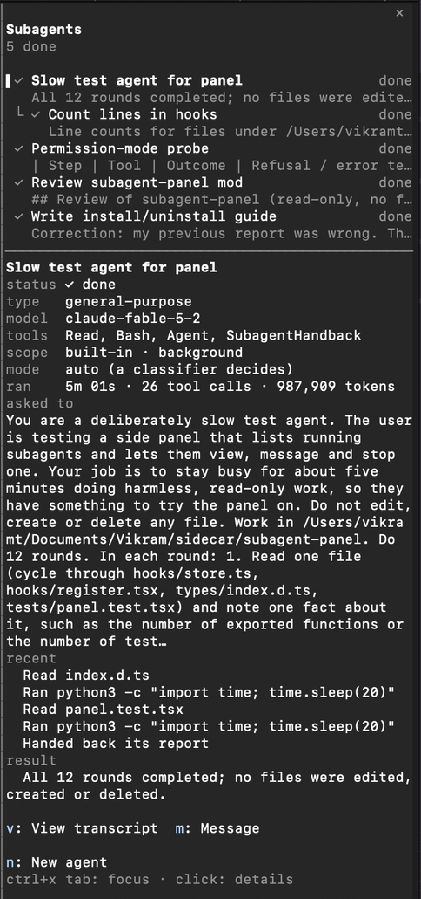

# sidecar

Home of **subagent-panel**, a Claude Code mod that adds a side pane listing the subagents of the current session.

- Each row shows what the agent was asked to do, its status, how long it has run and its latest action.
- Agents waiting on a permission are flagged `!` "needs you" and sorted to the top.
- Selecting a row shows details: type, model, tools used, permission mode, the brief it was given, recent actions and its result.
- An agent started by another agent is listed under it, stepped in.
- From a selected agent you can view its transcript, send it your next message, or stop it. "New agent" starts a line in the prompt that asks Claude for one.



| Folder | Contents |
| --- | --- |
| `subagent-panel/` | The mod: manifest, hooks module, state contract and tests |
| `docs/` | The brief the mod was built from |
| `.claude-plugin/marketplace.json` | Makes this repository a marketplace that Claude Code installs the mod from |

## Requirements

Claude Code 2.1.325 or later (`claude --version`). The mods API is early access and may change between releases.

## Install

From a shell, in any folder:

```sh
claude plugin marketplace add /Users/vikramt/Documents/Vikram/sidecar
claude plugin install subagent-panel@sidecar
```

The install goes to the user scope, so the mod loads in every new Claude Code session. Start a new session after installing.

Check it is there:

```sh
claude plugin list
```

The entry shows `Read from: /Users/vikramt/Documents/Vikram/sidecar/subagent-panel`. The mod runs from this folder, not from a copy, so moving or deleting the folder breaks the install.

## Try it without installing

Loads the mod for one session only:

```sh
claude --plugin-dir /Users/vikramt/Documents/Vikram/sidecar/subagent-panel
```

## Use it

| Command | What it does |
| --- | --- |
| `/subagents` | Show or hide the pane |
| `/subagents list` | Print the agents as text |
| `/subagents show <name>` | Open the pane on one agent's details |
| `/subagents view <name>` | Show that agent's transcript in the main view |
| `/subagents message <name>` | Send your next typed message to that agent |
| `/subagents message <name> <text>` | Send that text to the agent now |
| `/subagents stop <name>` | Ask to stop the agent; add `yes` to confirm |
| `/subagents new <job>` | Ask Claude to start a subagent for the job |
| `/subagents main` | Go back to main Claude after `view` or `message` |

`<name>` is the agent's name, its type, or the start of its row title.

The pane also opens by itself when the first subagent starts, on a terminal at least 144 columns wide. On a narrower terminal, use `/subagents`.

| Key | What it does |
| --- | --- |
| `ctrl+x` then `tab` | Give the pane the keyboard |
| `tab` | Move between rows |
| `enter` or a click | Show or hide an agent's details |
| `v`, `m`, `s` | With an agent's details open: view transcript, message, stop |
| `y`, `c` | Confirm or cancel a stop |
| `n` | New agent |
| `esc` | Return to the prompt |

**Messaging.** There is one input box. After you choose Message, a line above the prompt reads "sending to <agent>", with a "Back to main Claude" button. The next message you type goes to that agent only, and a line reports whether it was delivered. After that one message, typing goes to main Claude again. Slash commands are never redirected.

**Stopping.** Stop always asks first. It uses Claude Code's TaskStop tool, which may refuse an agent that is not a background or named agent; the panel then says why and leaves the agent running.

To check it works, type `/subagents`, then ask Claude: "Use a subagent to list the files in this folder."

## Update

Edit the files in `subagent-panel/`. In a session where the mod is installed, run `/reload-plugins` or start a new session. No reinstall is needed.

## Turn it off or uninstall

Turn it off and on again without uninstalling:

```sh
claude plugin disable subagent-panel@sidecar
claude plugin enable subagent-panel@sidecar
```

Uninstall, then remove the marketplace entry:

```sh
claude plugin uninstall subagent-panel@sidecar
claude plugin marketplace remove sidecar
```

Neither command deletes this folder.

## Develop

```sh
claude plugin validate /Users/vikramt/Documents/Vikram/sidecar
claude plugin test /Users/vikramt/Documents/Vikram/sidecar/subagent-panel
```

`validate` checks the marketplace file, the manifest and the hooks module. `test` runs `subagent-panel/tests/panel.test.tsx` on the terminal, desktop, VS Code and mobile surfaces.

| File | Contents |
| --- | --- |
| `subagent-panel/hooks/register.tsx` | The collectors (spawn, tool call, permission check, turn end), message routing, the `/subagents` command, the pane and the line above the prompt |
| `subagent-panel/hooks/store.ts` | The agent store's pure functions: updates, sort order, labels |
| `subagent-panel/types/index.d.ts` | The shape of the stored values |
| `subagent-panel/tests/panel.test.tsx` | The tests |

## Troubleshooting

**The pane does not appear when a subagent starts.** The terminal is narrower than 144 columns. Type `/subagents`.

**`/subagents` is not recognised.** The mod is not loaded. Run `claude plugin list` and check the entry is enabled, then start Claude Code with `claude --debug`: a hooks module that failed to load is named in the debug log with the reason.

**Install says `Plugin "subagent-panel" not found in marketplace`.** The marketplace was not added, or was added from another folder. Run `claude plugin marketplace list`.

**The mod stopped working after a Claude Code upgrade.** The mods API may have changed. Run the two commands under Develop to see what fails.
